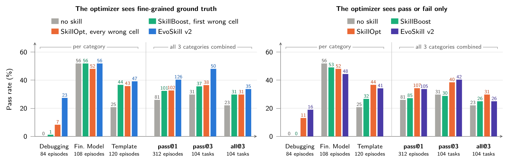
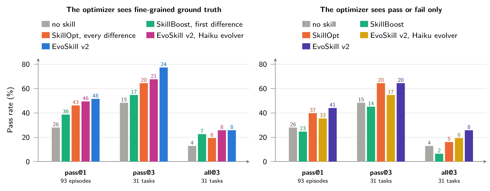
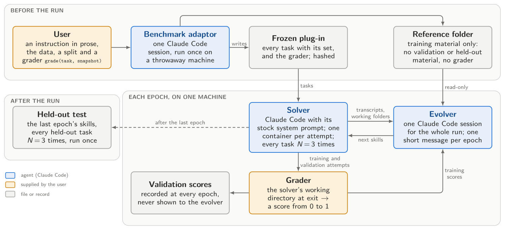

<div align="center">
    
    <br>
    <h1>EvoSkill v2: Fully Agentic Skill Evolution<br>from Benchmark Adaptation to a Stateful Evolver</h1>
</div>

<p align="center">
  <a href="https://arxiv.org/abs/2610.25931"></a>
  <a href="https://openreview.net/forum?id=i4b4As7RFX"></a>
  <a href="https://sentient.xyz"></a>
  <a href="https://x.com/SentientAGI"> </a>
  <a href="./LICENSE"></a>
</p>

**EvoSkill v2 improves an agent by rewriting its skills** — folders, each a `SKILL.md` file and optional helper scripts, that Claude Code opens when a task matches the skill's description — and leaves the model and the harness as they are. It is three Claude Code agents:

- **Benchmark adaptor (BA)** — runs once, before any skill exists. From your prose instruction, your data, your split and your grader, it writes a frozen plug-in that lists every task with its set, and a reference folder of training material.
- **Solver** — attempts the tasks with the current skills: every task three times, each attempt in its own container, each scored by your grader.
- **Evolver** — one Claude Code session with a bash tool for the whole run. Each epoch it is given every training attempt (session logs, working folders, scores), the reference folder, its earlier skills and its own notes; it reads what it chooses and writes the next skills. It never sees validation or held-out tasks.

EvoSkill v2 succeeds [EvoSkill](https://openreview.net/forum?id=i4b4As7RFX) (Alzubi et al.), which lives on the `main` branch.

<a id="results"></a>

## 📊 Results

We compare EvoSkill v2 with two other skill optimizers, [SkillOpt](https://arxiv.org/abs/2605.23904) and [SkillBoost](https://arxiv.org/abs/2607.26643), on two benchmarks, with the same solver for all three and Claude Sonnet 5.5 as every optimizer (two more τ³ runs use Haiku 5.5 as EvoSkill v2's evolver). Each method kept its own optimization loop. Every held-out task ran three times, once, after optimization ended. We ran each comparison twice. With **fine-grained ground truth**, EvoSkill v2's reference folder holds the training answers, and each baseline gets what the grader found wrong in each failed training attempt, as its own code passes it on: SkillOpt every wrong cell, SkillBoost only the first (on τ³, the database fields that differ from the expected database, or the expected tool calls not made). With **pass or fail only**, every optimizer's grading signal is whether each training attempt passed; each still reads the attempts themselves.

**SpreadsheetBench v2** (Claude Sonnet 5.5 solver; 104 held-out tasks × 3 attempts). With fine-grained ground truth, EvoSkill v2's skills passed **126 of 312** held-out episodes, against 102 for SkillOpt and 101 for SkillBoost (81 with no skill). The gain is in Debugging, which the solver never passed without a skill (0 → 23 of 84), and in Template (25 → 47 of 120); Financial_Model stayed at 56 of 108. With pass or fail only, EvoSkill v2 passed 105, on par with SkillOpt's 107, with an evolver that cost **$0.53** against SkillOpt's $6.65.

<div align="center">
  
</div>

**τ³-bench banking** (Claude Haiku 5.5 solver; 31 held-out tasks × 3 attempts). EvoSkill v2's skills passed **48 of 93** held-out episodes with fine-grained ground truth, against 43 for SkillOpt and 36 for SkillBoost (26 with no skill), and 41 with pass or fail only, against 37 and 23 (for SkillOpt, the skill its code keeps on validation; its last skill passed 34 and 40). With the solver's own model, Haiku 5.5, as its evolver, EvoSkill v2 passed 46 and 33: a weaker model improving its own skills.

<div align="center">
  
</div>

**What the optimizer costs.** Claude Code's list-price estimate for the optimizer alone, over the whole run; the solver's attempts are not included.

| Optimizer | SSB v2, fine-grained | SSB v2, pass or fail | τ³, fine-grained | τ³, pass or fail |
|---|---:|---:|---:|---:|
| SkillBoost | $13.95 | $13.66 | $6.98 | $8.64 |
| SkillOpt | **$8.56** | $6.65 | $5.55 | $6.22 |
| EvoSkill v2 | $12.84 | **$0.53** | **$0.99** | $1.55 |
| EvoSkill v2, Haiku 5.5 evolver | — | — | $1.87 | **$0.73** |

Each configuration ran once. On SpreadsheetBench v2, EvoSkill v2's pass-or-fail run used Claude Code 2.1.293 and every other run 2.1.281, so costs across that line are not directly comparable. The [tech report](https://arxiv.org/abs/2610.25931) gives the per-epoch scores and how each baseline was run.

## 🧭 How it works

<div align="center">
  
</div>

1. **Adapt (once).** The BA reads your instruction, data, split and grader on a throwaway machine whose network reaches only the model API, and writes the plug-in and the reference folder. The plug-in and the grader are frozen and hashed; nothing later may change them.
2. **Roll out.** The solver attempts every validation task, and every training task except in the last epoch (no evolver turn follows it), three times with the current skills, each attempt in its own container. Your grader scores the solver's working directory at exit.
3. **Evolve.** The evolver reads the training attempts and their scores and writes the next skill set. Its container receives only the training attempts, the skill sets and the BA's reference folder; the reference folder is uploaded as the BA wrote it, so check that it holds no validation or held-out material.
4. **Measure.** Validation scores are recorded at every epoch and never shown to the evolver. Every epoch's skills are kept; none is rejected on a score.
5. **Test once.** After the last epoch, the last epoch's skills run once on the held-out tasks, three attempts each.

**Four design choices** set EvoSkill v2 apart from the optimizers we compared with (the [tech report](https://arxiv.org/abs/2610.25931) argues each):

- **The evolver is an agent with a bash tool.** SkillOpt's optimizer is a sequence of single model calls. EvoSkill v2's evolver runs Python over the attempts, recalculates a workbook, and can test an explanation of a failure before writing it into a skill.
- **The evolver is stateful.** SkillBoost's optimizer starts a new agent session every round; EvoSkill v2's evolver is one session for the whole run: its notes, its scripts, every earlier epoch's attempts and every skill set it wrote stay available, so a later turn can keep, revert or combine anything tried so far.
- **Several attempts per task.** The solver does not pass or fail a task the same way every time; with three attempts the evolver can tell a failure that repeats from one that does not.
- **Every epoch's skills are accepted.** Keep-or-reject checks on one attempt per task decide on gaps within that run-to-run variation; EvoSkill v2 keeps every skill set and tests the last epoch's.

## 🧪 Supported benchmarks

| Benchmark | Tasks used | Notes |
|---|---|---|
| [SpreadsheetBench v2](https://huggingface.co/datasets/KAKA22/SpreadsheetBench-v2) | 218: 57 training, 57 validation, 104 held-out | Debugging, Financial_Model and Template. Graded cell by cell against the reference workbook after a LibreOffice recalculation. A byte overlay repairs five malformed input workbooks. |
| [τ³-bench](https://github.com/sierra-research/tau2-bench) banking | 70: 19 training, 20 validation, 31 held-out | Graded on the bank's final database state or on the expected tool calls. The simulated customer is GPT-6 Luna through OpenRouter. Runs on a data root built from tau2-bench commit `363133a`, with its document-embeddings cache. |
| Your benchmark | — | Bring a prose instruction, the data, a split and a grader (below). The solver harness supports workbook-editing tasks and τ³-style conversations; another kind of task needs its own harness branch. |

## 🛠️ Installation

**Requirements**

- **A macOS host** with Python **3.12+** and [`uv`](https://docs.astral.sh/uv/). The host only drives the run, but the plug-in freeze runs the BA's plug-in under macOS `sandbox-exec`, so a Linux host is not supported yet.
- **[Daytona](https://www.daytona.io/)** (`DAYTONA_API_KEY`): everything that needs isolation runs on one 8 vCPU / 32 GiB Daytona machine per run, plus a short-lived one for the BA. A local Docker backend is planned.
- **Claude access** for the three Claude Code agents: a Claude subscription token (`claude setup-token`, saved to a file with mode `600`), or an `ANTHROPIC_API_KEY`. If a session hits its usage limit, the run waits for the limit to reset and continues. Claude Code itself (a pinned Linux build) is downloaded and checked against its sha256 before the first attempt.
- **τ³ only:** an OpenRouter API key, for the simulated customer and the solver's knowledge-base search, and once to build the document-embeddings cache.
- The benchmark data: [SpreadsheetBench v2](https://huggingface.co/datasets/KAKA22/SpreadsheetBench-v2), or tau2-bench at commit `363133a` (see [`third_party/README.md`](third_party/README.md)).

```bash
# EvoSkill v2 lives on the `v2` branch; `main` is EvoSkill v1.
git clone -b v2 https://github.com/sentient-agi/EvoSkill.git EvoSkill && cd EvoSkill
uv sync --extra daytona
cp .env.example .env                                # DAYTONA_API_KEY; OPENROUTER_API_KEY for τ³
export EVOSKILL_CC_TOKEN_FILE=~/.claude_token       # or: export ANTHROPIC_API_KEY=...
```

## 🚀 Run an experiment

A run starts from **your instruction**: a page of prose that describes the benchmark to the BA, the way you would brief a colleague. It covers five things:

1. **Benchmark, data and split**: what the tasks are, how the data is laid out, and which tasks go to training, validation and the held-out set.
2. **What the solver gets and must produce**: e.g. an input workbook and the path to save the edited one.
3. **The grader**: your `grade(task, snapshot)` and what it reads.
4. **The environment**: the image the solver and the grader run in.
5. **Run size**: epochs and attempts per task, e.g. `3 epochs · 3 samples per task` (our runs). A run without it is refused.

The instruction also decides what the evolver may see. In our runs with fine-grained ground truth the reference folder held the training tasks' answers; say so in the instruction if the evolver should not get them, and the BA leaves them out.

`examples/ssbv2/` and `examples/tau3_banking/` hold the instructions, splits and graders we used. Hand them over with the data. The BA sees the data folder as `/data/<its folder name>`, and the example instructions name `/data/spreadsheetbench-v2` and `/data/tau3_data_363133a`, so `--data` must be a folder with that name:

```bash
# SpreadsheetBench v2: --data is the dataset's spreadsheetbench-v2 folder
uv run evoskill run --task-type workbook --instruction examples/ssbv2/instruction.md \
    --data /path/to/spreadsheetbench-v2 --split examples/ssbv2/split.json \
    --grader examples/ssbv2/grader.py --run-dir runs/ssb

# τ³-bench banking: build the data root once, then run (Haiku 5.5 solver, Sonnet 5.5 evolver by default)
uv run python scripts/tau3_make_data_root.py --dest /path/to/tau3_data_363133a
uv run python scripts/tau3_build_embeddings_cache.py --root /path/to/tau3_data_363133a
uv run evoskill run --task-type tau3 --instruction examples/tau3_banking/instruction.md \
    --data /path/to/tau3_data_363133a --split examples/tau3_banking/split.json \
    --grader examples/tau3_banking/grader.py --run-dir runs/tau3
```

`evoskill run` goes through five steps, and the run needs no further input:

1. **init**: writes the run's settings (`SPEC.json`, `INFRA.json`, `RUNTIME.json`) and reads the run size from the instruction.
2. **adapt**: the BA builds the plug-in and the reference folder; the plug-in and your grader are frozen and hashed.
3. **base**: the solver's no-skill attempts on the training, validation and held-out tasks.
4. **evolve**: the epochs: evolver turn, then the solver's attempts with the new skills.
5. **test**: the last epoch's skills on the held-out tasks; then the run's machine is deleted.

Run the same command again to resume a stopped run; a step whose result is complete is skipped, and a changed input is refused. `--stop-after <step>` stops after a step, `--dry-run` prints every check and command without running anything, `evoskill status --run-dir runs/ssb` shows where a run is, and `evoskill stop --run-dir runs/ssb` stops it without ending the evolver's session. `--solver-model`, `--evolver-model` and `--adaptor-model` choose the models (Claude Sonnet 5.5 for all three on `workbook`; on `tau3` a Haiku 5.5 solver, a Sonnet 5.5 evolver and adaptor), and `--concurrency` the solver attempts in flight (default 30).

**Your grader** is one function. The BA reads it, but neither it nor the evolver can change it:

```python
def grade(task, snapshot: Path) -> float:
    """task: one row of the plug-in (id, category, instruction, inputs, answer_files, grading, split).
    snapshot: the solver's working directory at the end of the attempt.
    (On τ³ it also holds the bridge's record of the conversation and the final database.)
    Return a score from 0 to 1; 0.999 or more is a pass. If grade() raises, times out
    or returns anything else, the attempt is graded once more; a second failure records
    it as grader_failed, which the reported pass counts treat as not passed."""
```

**What a run folder holds** (for a run folder named `ssb`)

```
runs/ssb/
  RUN.json                                 your inputs, hashed, and the run size
  SPEC.json  INFRA.json  RUNTIME.json      the run's settings; SPEC.json is frozen and hashed before the first epoch
  setup/                                   the plug-in, tasks.json, split.json and your grader, hashed
  reference/                               the evolver's training material
  skills_v1/ … skills_v3/                  the skill set after each evolver turn
  evo_e0/ … evo_e2/                        what the evolver received at each turn
  ssb_base_{train,val,test}.json           per-leg results: every task, every attempt
  ssb_v{1,2,3}_val.json  ssb_v{1,2}_train.json  ssb_v3_test.json
```

## 📁 Layout

```
src/orchestrator/          epoch loop, run spec, plug-in runner, the loop's side of the evolver session
src/orchestrator/prompts/  the evolver's appended system prompt and per-epoch message
src/run.py                 the evoskill command
scripts/daytona/           machine host, leg driver, evolver container and session, BA launcher, images
scripts/cc_solver/         the solver's Claude Code session
scripts/tau3_cc/           the bridge between Claude Code and τ³-bench's orchestrator
examples/                  instructions, splits and graders for SpreadsheetBench v2 and τ³ banking
```

## Citation

```bibtex
@misc{huang2026evoskillv2,
      title={EvoSkill v2: Fully Agentic Skill Evolution from Benchmark Adaptation to a Stateful Evolver},
      author={Dastin Huang and Baran Nama and Salaheddin Alzubi},
      year={2026},
      eprint={2610.25931},
      archivePrefix={arXiv},
      primaryClass={cs.AI},
      url={https://arxiv.org/abs/2610.25931},
}
```

EvoSkill v2 builds on EvoSkill:

```bibtex
@inproceedings{alzubi2026evoskill,
      title={EvoSkill: Automated Skill Discovery for Agents},
      author={Salaheddin Alzubi and Noah Provenzano and Christian Alexander Calvo and Jaydon Bingham and Weiyuan Chen and Himanshu Tyagi and Dastin Huang and Tu Vu},
      booktitle={The First Workshop on Agent Skills (Agent Skills '26) at the ACM Conference on AI and Agentic Systems (CAIS 2026)},
      year={2026},
      url={https://openreview.net/forum?id=i4b4As7RFX}
}
```

## License

This project is licensed under the Apache 2.0 License — see the [LICENSE](LICENSE) file for details.
