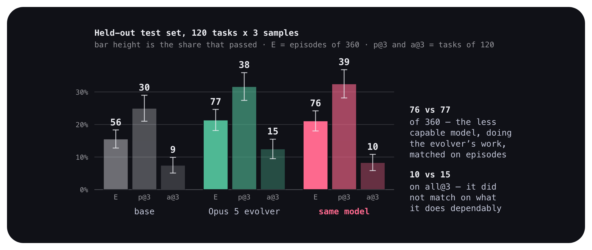
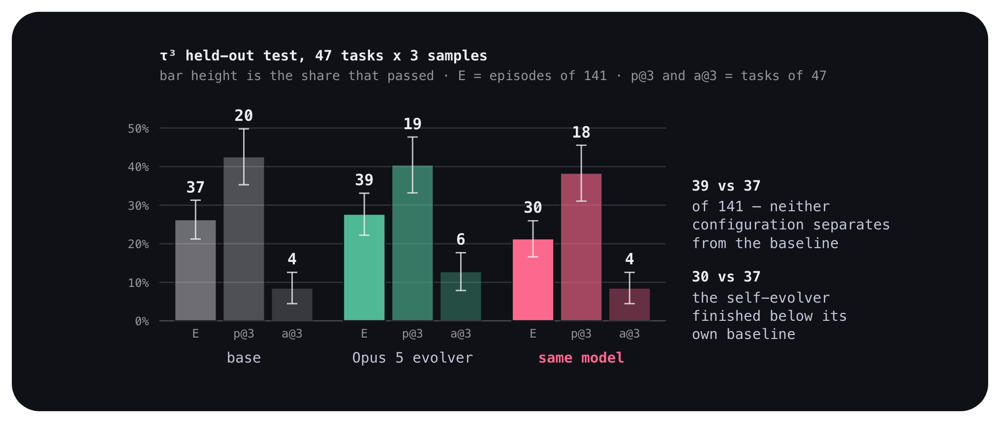
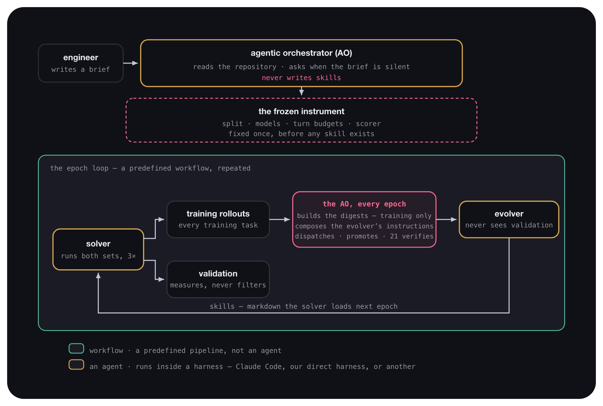

<div align="center">
    
    <br>
    <h1>EvoSkill v2: Agentic Skill Evolution Against a Frozen Instrument</h1>
</div>

<p align="center">
  <a href="https://www.alphaxiv.org/abs/2603.02766"></a>
  <a href="https://www.sentient.xyz/blog/evoskill-automated-skill-induction-from-agent-failures"></a>
  <a href="https://sentient.xyz"></a>
  <a href="https://x.com/SentientAGI"> </a>
  <a href="./LICENSE"></a>
</p>

<b>EvoSkill v2 is a system of three agents that improves a fourth thing you already have: your agent harness.</b> The <b>solver</b> does the task. The <b>evolver</b> reads the solver's failed rollouts and rewrites the skills the solver uses — short markdown files loaded into its context. The <b>agent orchestrator (AO)</b> turns a short prose brief into a complete, frozen experiment and drives the loop: rollout legs, evolver dispatch, verification gates, and a held-out test run once at the end.

<b>None of the three replaces the harness you already run.</b> The solver and the evolver each execute inside one — Claude Code, our own direct harness, or another — and EvoSkill v2 is the layer above them. That is why it is three agents and not one.

<b>EvoSkill v2</b> succeeds <b><a href="https://arxiv.org/abs/2603.02766">EvoSkill</a></b> (Alzubi et al., same team). Where v1 optimizes a program against a dataset, v2 adds the piece that makes the result trustworthy: <b>an orchestrator that freezes the measurement before any skill exists</b>, and is not allowed to change it afterwards. The evolver works inside that instrument and can never widen the training set, reinterpret which tasks count, or see held-out data.

This release contains the minimal code to run skill evolution on two benchmarks: <b>τ³-bench banking</b> (multi-turn customer service, graded on final database state) and <b>SpreadsheetBench v2</b> (spreadsheet editing, graded cell-by-cell against a reference workbook).

<a id="results"></a>

## 📊 Results

Two benchmarks, three configurations each: **no skills**, an **Opus 5 evolver** writing skills for a
DeepSeek V4 Flash solver, and that **same DeepSeek V4 Flash model writing skills for itself**. Every
task runs three times, because the task and the environment are stochastic and not only the model.
Each held-out set ran once, after evolution had finished, under the version fixed in advance. Whiskers on the charts are one standard error, computed across tasks rather than across episodes, because the three samples of one task are not independent.

<div align="center">
  
</div>

The gain concentrates in the one category that started at the floor. **Debugging went from 3 of 120
episodes to 21**, while Financial_Model — the category the solver was already competent at — did not
move at all (32 of 120 either way). That is the mechanism: a written rule supplies an approach where
the agent had none, and adds little where it already had one.

The less capable model, doing the evolver's work for itself, **reached the same episode total as the
frontier model** (76 against 77 of 360). It was not as dependable: 10 tasks passed all three samples
against 15, and it put its episodes in a different category (Debugging 14, Financial_Model 38).

<div align="center">
  
</div>

On τ³ banking **neither configuration separates from the baseline**, and we report that as it came
out. The skills did change behavior in the direction they were written for — episodes that never
reached grading fell from 22 of 141 to 14 with the Opus 5 evolver and to 15 with the same-model one —
but an agent that ends a stuck conversation still has to be right about the work. The remaining
failures needed correct answers, and instructions did not supply them.

The two results are one finding rather than a win and a loss: this method turns non-attempts into
attempts, and that pays only where an attempt was the thing missing.

**What a run costs.** These are billed figures, metered per call by the provider rather than
estimated from a price table. A three-epoch evolution is 1,080 solver episodes — 60 training and 60
validation tasks at three samples each, over three epochs — and came to about **$27** with the Opus 5
evolver and about **$25** with the same-model one. The held-out test leg adds 360 episodes, about
**$10**. Per episode the three configurations land within a third of a cent of each other — $0.0258
with no skills, $0.0253 and $0.0229 evolved — so the skills change what the solver does, not what it
spends. The evolver and the AO sit outside these totals: both run inside a coding subscription,
billed by the seat and not by the call.

## 🧪 Supported benchmarks

<table>
  <thead>
    <tr>
      <th>Benchmark</th>
      <th>Support</th>
      <th>Notes</th>
    </tr>
  </thead>
  <tbody>
    <tr>
      <td><a href="https://github.com/sierra-research/tau2-bench">τ³-bench</a> — banking</td>
      <td>✅</td>
      <td>Multi-turn, simulated customer. Graded on final database state; one zeroed component zeroes the episode.</td>
    </tr>
    <tr>
      <td><a href="https://github.com/RUCKBReasoning/SpreadsheetBench-2">SpreadsheetBench v2</a></td>
      <td>✅</td>
      <td>All-or-nothing cell comparison over the ranges each task names. Needs the Docker images below.</td>
    </tr>
    <tr>
      <td>Other τ³ domains (retail, airline, telecom)</td>
      <td>🛠️</td>
      <td>The adapter is domain-parameterised, but only banking ships with a frozen split and a verified base leg.</td>
    </tr>
  </tbody>
</table>

## 🎨 Features

<table>
  <thead>
    <tr>
      <th>Capability</th>
      <th>Status</th>
      <th>Explanation</th>
    </tr>
  </thead>
  <tbody>
    <tr>
      <td><b>Prose brief → frozen experiment</b></td>
      <td>✅</td>
      <td>
        The AO reads your repository, resolves what the brief means, cites the file and line behind each answer, and freezes the split, models, budgets and scorer. The τ³ brief we ship is 413 words in five sections.
      </td>
    </tr>
    <tr>
      <td><b>It refuses rather than guesses</b></td>
      <td>✅</td>
      <td>
        Faced with a contradiction, an impossible split, or vagueness where a number belongs, the AO leaves the field empty and puts the question back to you. Sizing numbers decide what a study can detect, so it will not pick them for you.
      </td>
    </tr>
    <tr>
      <td><b>Evolver containment</b></td>
      <td>✅</td>
      <td>
        The evolver is kernel-confined away from held-out task specs via <code>sandbox-exec</code>, and is given no validation or held-out data and no score for its own output. macOS only — see <a href="#platform-notes">Platform notes</a>.
      </td>
    </tr>
    <tr>
      <td><b>Comparability gate</b></td>
      <td>✅</td>
      <td>
        <code>compare_runs()</code> refuses to compare two runs unless 15 instrument fields plus the split hash, sealed-test flag and sample count all match. An absent field is not a match, and a non-varying treatment raises rather than returning a result.
      </td>
    </tr>
    <tr>
      <td><b>Resumable epochs + replay cache</b></td>
      <td>✅</td>
      <td>
        Every rollout is content-addressed and replayable, so a killed run resumes without re-buying episodes. The cache identity includes the model, the wall, the user-simulator and the skill version.
      </td>
    </tr>
    <tr>
      <td><b>Human gates that are not automatable</b></td>
      <td>✅</td>
      <td>
        The loop halts twice per epoch — once on the AO-authored evolver prompt, once on the evolved skills — and requires a written receipt with the sha256 of what you read.
      </td>
    </tr>
    <tr>
      <td><b>Phoenix tracing</b></td>
      <td>✅</td>
      <td>
        Optional. Live evolver spans and AO session replay into a local Phoenix server. Everything degrades gracefully without it.
      </td>
    </tr>
    <tr>
      <td><b>Harness-selectable solver and evolver</b></td>
      <td>🛠️</td>
      <td>
        The containment layer is built and proved for <code>direct</code> and <code>claude</code>; full spec wiring is not finished.
      </td>
    </tr>
    <tr>
      <td><b>Linux parity</b></td>
      <td>🛠️</td>
      <td>
        Containment relies on macOS <code>sandbox-exec</code>. Linux runs today only via a recorded opt-out.
      </td>
    </tr>
  </tbody>
</table>

## Table of Contents

- [Results](#results)
- [Installation](#installation)
- [Quickstart](#quickstart)
- [Bootstrap epoch 1](#bootstrap-epoch-1-base-legs-oracle-declarations)
- [Drive the epoch](#drive-the-epoch)
- [Model routing](#model-routing)
- [Platform notes](#platform-notes)
- [How it works](#how-it-works)
- [Tests](#tests)
- [Layout](#layout)
- [Citation](#citation)
- [License](#license)

---

## Installation

**Requirements:**

- Linux or macOS. Python **3.12+**. [`uv`](https://docs.astral.sh/uv/).
- **Docker** — native on Linux; on macOS use [colima](https://github.com/abiosoft/colima). Give it as many CPUs as you can spare: `colima start --cpu 12 --memory 14` or larger, and keep `/Users` shared (the default). At 8 CPUs we measured heavy oversubscription at the default concurrency.
- **Claude Code CLI** (`npm install -g @anthropic-ai/claude-code`) and a **Claude subscription** — run `claude login`. The AO and the evolver run through the `claude` binary.
- An **OpenRouter API key** (`OPENROUTER_API_KEY`) for the solver model.
- `git`.

Copy `.env.example` to `.env` and fill in your keys.

> **An `ANTHROPIC_API_KEY` will NOT work for the AO or the evolver.** `subscription_env()` in `src/orchestrator/quota_scope.py` deliberately removes `ANTHROPIC_API_KEY`, `ANTHROPIC_AUTH_TOKEN` and `ANTHROPIC_BASE_URL` from every `claude` child running a Claude-family model. That is not an oversight (#307): the quota gate reads the subscription window, so a child silently spending API credit would leave the gate guarding a budget the run does not use. There are two entry points and therefore two mechanisms — `subscription_env()` covers the AO front door and the loop, and `scripts/tau3_evolver.sh` (the hand-run evolver path, which is not Python and never called it) unsets the same three itself. The key is still needed for solver models that reach Anthropic through a gateway.

**Setup:**

```bash
# EvoSkill v2 lives on the `v2` branch; `main` is EvoSkill v1.
git clone -b v2 https://github.com/sentient-agi/EvoSkill.git EvoSkill && cd EvoSkill
uv sync                          # main venv
uv sync --extra phoenix          # optional: Phoenix tracing at :6006
```

**1. Vendor the benchmark repos.** Clone-don't-vendor policy; exact pins and clone commands live in `third_party/README.md`.

- `tau3-bench` — the banking domain: tasks, code, and the venv every episode runs in (`uv sync --extra knowledge` for `rank_bm25`).
- `tau2-bench` — the v1.0.0 engine pin. Only needed if you set `TAU2_BENCH_ROOT` to point episodes at it instead; a plain τ³ run never launches it, so its venv is **optional**.

**2. Build the Docker images.** SpreadsheetBench v2 only — a τ³ banking run uses none of them.

```bash
docker build -t evoskill-solver-sandbox:latest docker/solver-sandbox/
docker build -t ssb-verifier:latest docker/ssb-verifier/     # grading image
bash scripts/build_ssb_solver_lo.sh                          # ssb-solver-lo:latest
```

`build_ssb_solver_lo.sh` builds its own base, then runs ~12 acceptance checks **inside** the built container — `soffice` present, `python3-uno` importable, the pinned `openpyxl`/`pandas`/`numpy` not shadowed, and a real formula → recalculated-value round trip. It refuses to hand over an image that fails any of them. If you already hold the frozen 2026-07-15 base tagged `ssb-solver:no-libreoffice-0715`, it is used and checked by ID — that is the reproduce-the-published-numbers path, not a build requirement.

**3. Point `SSBV2_ROOT` at your SpreadsheetBench v2 checkout** (SSB v2 only). Give it the directory containing the category dirs' parent: either `<root>/data/spreadsheetbench-v2/…` or `<root>/spreadsheetbench-v2/…` resolves — the loader tries both.

```bash
export SSBV2_ROOT=/path/to/SpreadsheetBench-v2

# Check it before going further. A wrong root does not raise: it warns per
# category and yields an EMPTY task list, which reads downstream as a run with
# nothing in it rather than as a misconfiguration.
uv run python -c "
import os
from pathlib import Path
from src.agent_profiles.ssbv2_agent.dataset import load_ssbv2
tr, va, te = load_ssbv2(Path(os.environ['SSBV2_ROOT']))
assert tr and va and te, 'SSBV2_ROOT is wrong — 0 tasks loaded'
print(f'SSBV2_ROOT OK: {len(tr)} train / {len(va)} val / {len(te)} test')"
```

Everything below runs through `uv run`, because `uv sync` installs the `evoskill` and `evoskill-loop` entry points into `.venv/bin` without putting them on your PATH. `source .venv/bin/activate` once instead if you prefer, and drop the prefix.

---

## Quickstart

The interface is a conversation with the AO. Write a short prose brief and hand it over:

```bash
cat > brief.txt <<'EOF'
Evolve a skill library for the banking domain of tau3-bench.
Solver is deepseek-v4-flash-0731, pinned to the native DeepSeek provider.
Three epochs. Hold out a test split and do not touch it.
EOF

uv run evoskill new --brief brief.txt \
    --root-hint third_party/tau3-bench \
    --run-dir outputs/my_run \
    --benchmark tau3
```

The AO reads the repository, resolves what the brief means, asks you about anything it refuses to pick on its own (split sizes, budgets), and freezes the experiment.

Headless: `--script` takes a **path** to a JSON file of pre-recorded answers, not inline JSON —

```bash
echo '{"seed": 801, "n_samples": 3}' > script.json && … --script script.json
```

> **Write down the split filename it prints.** The freeze receipt names the split it wrote — `split_<n_train><n_val><n_test>.json`, e.g. `split_325.json` for 3/2/5 — and every bootstrap step below needs that exact name. It is **not** `split.json`.

### Bootstrap epoch 1: base legs, oracle, declarations

The driver measures an epoch against a no-skills **base** comparator, and it does not run that comparator for you. The base legs are yours, so that what everything is compared against was launched and read by a person.

```bash
export EVOSKILL_ENV_FILE=$PWD/.env                                # holds OPENROUTER_API_KEY
export EVOSKILL_TAU3_SPLIT=$PWD/outputs/my_run/split_325.json     # EXACT name from the receipt
export EVOSKILL_TAU3_RUN_DIR=outputs/my_run
export EVOSKILL_TAU3_CACHE_TAG=<cache tag from the freeze receipt>
export EVOSKILL_SOLVER_MODEL=<solver model from the receipt>      # same model as the evolved legs

scripts/tau3_leg_b2525.sh my_run_base_train train BASE
scripts/tau3_leg_b2525.sh my_run_base_val   val   BASE

# The evolver's ground-truth oracle (train tasks only, by construction):
EVOSKILL_TAU3_ORACLE_SPLIT=$PWD/outputs/my_run/split_325.json \
EVOSKILL_TAU3_ORACLE_DIR=$PWD/outputs/my_run/oracle \
    uv run python scripts/make_tau3_oracle.py   # then --verify
```

All three `EVOSKILL_TAU3_*` exports **and `EVOSKILL_SOLVER_MODEL`** are mandatory. The launcher refuses without them rather than defaulting, because a defaulted cache tag would mix this run's episodes into another run's cache bucket.

When both base result JSONs exist, declare them once in `outputs/my_run/RUNTIME.json` — the driver reads it on every invocation:

```json
{
 "base_leg": "outputs/my_run/my_run_base_train.json",
 "base_leg_val": "outputs/my_run/my_run_base_val.json",
 "digest_caches": [".cache/<the cache_dirs recorded in the base train JSON>"],
 "oracle": "outputs/my_run/oracle"
}
```

`digest_caches` must be copied from the `cache_dirs` field of the base **train** result JSON — the runner records the real directory names there, and the driver refuses to re-derive them.

<details>
<summary><b>The same bootstrap for SpreadsheetBench v2</b> — same shape, different launcher, three extra rules</summary>

<br>

`SSBV2_ROOT` must be exported for *every* later `evoskill-loop` invocation too — the loop passes it to the evolver's leak hook as the held-out data root.

`EVOSKILL_CACHE_DIR` is required by the leg launcher here. Its default is a per-tag dir that is empty for a new tag, so leaving it unset silently re-buys every episode. The loop sets its own per-epoch value when it launches legs itself, so exporting it later is harmless but does nothing.

`EVOSKILL_SOLVER_MODEL` is mandatory for **both** leg launchers, and on SSB v2 it must be a **dated snapshot** (`…-0731`, `…-0813`): the replay cache keys on the model string, so a rolling tag re-buys every episode under a model nobody chose. `scripts/ssbv2_leg.sh` refuses one with exit 4, and the freeze refuses it earlier — `ExperimentSpec.validate()` rejects an undated solver on this benchmark, so you find out before paying for the AO run and the oracle.

```bash
export EVOSKILL_CACHE_DIR=$PWD/.cache/<cache tag from the freeze receipt>_cache
export EVOSKILL_SOLVER_MODEL=<solver model from the freeze receipt>
export EVOSKILL_TAU3_RUN_DIR=outputs/my_ssb_run                      # the loop's var names
export EVOSKILL_TAU3_SPLIT=$PWD/outputs/my_ssb_run/split_325.json    # predate SSB v2

scripts/ssbv2_leg.sh my_ssb_run_base_train train ""   # "" = no skills = BASE
scripts/ssbv2_leg.sh my_ssb_run_base_val   val   ""

EVOSKILL_SSBV2_ORACLE_SPLIT=$PWD/outputs/my_ssb_run/split_325.json \
EVOSKILL_SSBV2_ORACLE_DIR=$PWD/outputs/my_ssb_run/oracle \
    uv run python scripts/make_ssbv2_oracle.py        # then --verify
```

Its `RUNTIME.json` additionally names the launcher, and `digest_caches` holds exactly **one** directory (SSB v2 uses a single cache dir, not τ³'s per-sample dirs):

```json
{
 "leg_script": "scripts/ssbv2_leg.sh",
 "base_leg": "outputs/my_ssb_run/my_ssb_run_base_train.json",
 "base_leg_val": "outputs/my_ssb_run/my_ssb_run_base_val.json",
 "digest_caches": [".cache/<cache tag>_cache"],
 "oracle": "outputs/my_ssb_run/oracle"
}
```

</details>

### Drive the epoch

```bash
uv run evoskill-loop --run-dir outputs/my_run --epoch 1 --drive --step \
    --note "first epoch"
```

Each `--drive --step` invocation advances one or more steps of the epoch — evidence surface, AO-authored evolver prompt, evolver dispatch, evolved legs, verification gates — and stops at the first HALT, question, or operator gate. Run it repeatedly and read what it printed before continuing. `--drive` without `--step` deliberately exits with code 64.

Expect to be stopped **twice at the human gate**: once to read the AO-authored evolver prompt, and once more to read the evolved skills. Each time, write `outputs/my_run/e1_PROOFREAD.json` with what you checked plus the sha256 of the prompt (and, the second time, of the staging dir). The gate is deliberately not automatable; the HALT message names the exact keys it wants.

---

## Model routing

- **DeepSeek-family solver models** are hard-pinned to the native DeepSeek provider (`order=["deepseek"], allow_fallbacks=false`) at every dispatch site. Third-party hosts serve these models with measurably different quality; the pin is enforced, not advisory.
- **DeepSeek-family models through the `claude` CLI** additionally require the local proxy: `python scripts/cc_proxy.py` (default `127.0.0.1:8100`), then `ANTHROPIC_BASE_URL=http://127.0.0.1:8100`. The dispatch guard (`scripts/lib/deepseek_pin_guard.sh`) refuses to launch without it.

## Platform notes

- **Evolver containment uses `sandbox-exec`** (macOS only) to kernel-confine the evolver away from held-out task specs. On Linux the dispatch refuses by default. The opt-out is `"evolver_sandbox": false` in the run's `RUNTIME.json` — a recorded decision, which is why it lives in the run's declaration rather than in the environment. Setting `EVOSKILL_EVOLVER_SANDBOX=0` in your shell has **no effect** on a driven epoch: the loop rebuilds that variable from the `RUNTIME.json` value on every dispatch, so an export is silently overwritten. It applies only when you run `scripts/tau3_evolver.sh` by hand.
- **The AO front door is a SEPARATE gate.** `evoskill new --brief` and the loop's prompt-authoring step both refuse on a host without `sandbox-exec` — which is every Linux host. `"evolver_sandbox": false` does **not** lift this; that key is read only for the evolver dispatch. The opt-out here is `EVOSKILL_AO_ALLOW_UNCONTAINED=1`, and it is a real trade: the AO then runs uncontained, regaining write access to the run directory — including `ANSWERS_e{N}.json` and `e{N}_PROOFREAD.json`, the files a later step reads back as the operator's own answers. Set it as a recorded decision, not a reflex. **On Linux it is the only way through**, for the brief front door and every driven epoch alike.
- **Phoenix tracing is optional.** Without a running Phoenix instance the loop's traces-in-phoenix check reports `UNMEASURED` and everything else runs.
- `caffeinate` (macOS sleep inhibitor) is used when present, skipped on Linux.

## How it works

<div align="center">
  
</div>

One epoch is five stages, and the separation between them is the point:

1. **Freeze** — the AO turns the brief into an experiment: split, models, budgets, scorer. This happens once, before any skill exists, and nothing downstream may change it.
2. **Roll out** — the solver attempts every training task, three times by default, because the task and the environment are stochastic and not only the model.
3. **Evolve** — the evolver reads one digest per training task (the reference specification, whether retrieval returned what the answer depends on, and every sample's verdict and full transcript) and writes skills. It never sees validation or held-out data, and never receives a score for its own output.
4. **Measure** — a validation run reports the new library's score. It **measures**; it does not filter. Every skill edit is promoted, because a bad edit produces the negative examples the next epoch learns from.
5. **Test once** — after the last epoch, the held-out set runs a single time.

## Tests

```bash
uv run pytest
```

## Layout

```
src/orchestrator/   AO front door (cli), v2 epoch loop, evolver dispatch + containment
src/harness/        direct + claude executors, seat pool, admission, liveness, fleet
src/cache/          rollout replay cache + cache-environment guard
src/agent_profiles/ solver agents (ssbv2_agent, tau2_agent = τ³ adapter) + skill_evolver
src/evaluation/     parallel evaluation driver
scripts/            leg launchers, evolver launcher, digest builders, split makers
docker/             solver sandbox, SSB solver images, SSB verifier (grading)
third_party/        vendored benchmark repos (gitignored; see its README)
```

## Citation

EvoSkill v2 builds on [EvoSkill](https://arxiv.org/abs/2603.02766). If you use it in your research, please cite:

```bibtex
@misc{alzubi2026evoskillautomatedskilldiscovery,
      title={EvoSkill: Automated Skill Discovery for Multi-Agent Systems}, 
      author={Salaheddin Alzubi and Noah Provenzano and Jaydon Bingham and Weiyuan Chen and Tu Vu},
      year={2026},
      eprint={2603.02766},
      archivePrefix={arXiv},
      primaryClass={cs.AI},
      url={https://arxiv.org/abs/2603.02766}, 
}
```

## License

This project is licensed under the Apache 2.0 License — see the [LICENSE](LICENSE) file for details.
