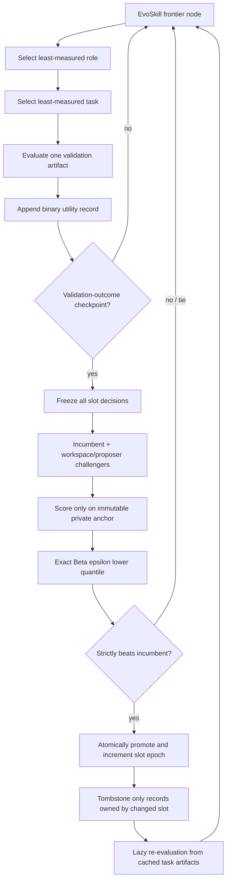

# RQGM controlled evaluator co-evolution

EvoSkill normally evolves an agent against a fixed scorer. The optional RQGM
layer implements the controlled-utility-evolution mechanism from *The Red
Queen Gödel Machine: Co-Evolving Agents and Their Evaluators*: learned
evaluators are frozen inside an epoch, can change only at validation-outcome
checkpoints, and are promoted only by evaluator-independent held-out anchors.

This is an implementation of the paper's evaluator co-evolution layer on top
of EvoSkill's existing frontier and mutation search. It intentionally does not
replace EvoSkill parent selection with RQGM's inherited HGM/CMP search, and it
does not implement Thompson/UCB scheduling. The boundary is explicit: EvoSkill
owns workspace expansion; `RQGMController` owns evaluator epochs, utility
records, replacement, erasure, and endpoint best-belief.

## Algorithm correspondence



The implementation follows these paper rules:

- One epoch vector entry is maintained per evaluator slot. Evaluators remain
  fixed between checkpoints.
- Checkpoints are counted in validation outcomes, not EvoSkill iterations.
  Batches are capped so a checkpoint boundary cannot be skipped.
- Each slot compares its incumbent with challengers on the same immutable
  anchor. Anchor examples never enter proposer context or serialized state.
- A candidate with `S` successes and `F` failures receives
  `scipy.stats.beta.ppf(epsilon, 1 + S, 1 + F)`. At least five valid anchor
  outcomes are required by default.
- Multi-slot decisions are planned against the old epoch vector and committed
  atomically. A tie keeps the incumbent.
- A real replacement invalidates only learned records dependent on that slot.
  Fixed criteria and learned records owned by unchanged slots survive.
- Validation scheduling is hierarchical: least-measured role first, then the
  least-measured task in that role. Node outcomes also expose the paper's
  pooled HGM-compatible Beta working posterior as `pooled_score`.
- A node is selectable only when every active role/task cell has current
  evidence and the pooled evidence meets `minimum_node_outcomes`.
- Training feedback is lineage evidence only. It never enters validation
  posterior counts.
- The run returns a generalist computed by uniformly averaging task
  best-beliefs within roles and then roles, plus per-role specialists.
  Evaluator-dependent task-agent scores are epoch-local, not globally
  comparable across evaluator replacements.

## CLI configuration

Evaluator evolution is disabled by default. Add this section to
`.evoskill/config.toml`:

```toml
[evaluator_evolution]
enabled = true
epsilon = 0.05
minimum_anchor_outcomes = 5
minimum_node_outcomes = 5
checkpoint_start = 32
checkpoint_ratio = 2.0
checkpoints = []
anchor_repeats = 1
state_path = ".evoskill/rqgm_state.json"
runtime_factory = "my_project.rqgm_runtime:build_runtime"
```

Set `checkpoints = [32, 64, 128]` to use explicit boundaries. When that list
is empty, the exponential `checkpoint_start`/`checkpoint_ratio` schedule is
used. The CLI applies these statistical settings itself; a runtime factory
cannot silently override them.

## Runtime factory

TOML must not contain private anchors or executable evaluator code. The
factory supplies those non-serializable capabilities as an `RQGMRuntime`:

```python
from src.evaluation import (
    AnchorExample,
    CallableEvaluatorExecutor,
    EvaluatorCandidate,
    EvaluatorSlot,
    InMemoryAnchorProvider,
    OutcomeAdapter,
    RQGMRuntime,
    RoleTask,
)


async def judge(candidate, artifact, expected, context):
    # Run candidate.artifact in a domain-specific restricted evaluator.
    return await run_restricted_judge(candidate.artifact, artifact, expected)


def build_runtime(config):
    anchor = InMemoryAnchorProvider(
        provider_id="review-anchor",
        version="v1",
        examples=[
            AnchorExample("a-001", private_artifact_1, expected_label_1),
            AnchorExample("a-002", private_artifact_2, expected_label_2),
            # Keep at least five independent outcomes in a real run.
        ],
    )
    incumbent = EvaluatorCandidate.create(
        slot_id="reviewer",
        role_id="writer",
        artifact={"prompt": "initial review rubric"},
        source="seed",
    )
    slot = EvaluatorSlot(
        slot_id="reviewer",
        role_id="writer",
        incumbent=incumbent,
        anchor_provider=anchor,
        executor=CallableEvaluatorExecutor(judge),
        proposer=make_evaluator_proposer(config),
        outcome_adapter=OutcomeAdapter(threshold=0.8),
    )
    return RQGMRuntime(
        slots=[slot],
        role_tasks=[
            RoleTask("writer", "paper-writing", "learned", "reviewer"),
            RoleTask("reviewer", "anchor-review", "fixed"),
        ],
    )
```

`make_evaluator_proposer` may return an `AgentEvaluatorProposer`, a
`CallableEvaluatorProposer`, or `None`. A domain adapter may also turn an
evaluator produced by the EvoSkill workspace into an `EvaluatorCandidate` and
call `controller.register_challenger(candidate)`. Registered candidates become
eligible at exactly the next checkpoint. This is the bridge that makes the
evaluator a workspace-evolved object rather than a hand-authored rotating
scorer.

Use `SandboxedEvaluatorExecutor` when evaluator artifacts execute code. Its
backend contract disables network access and persistent filesystem writes;
the domain backend is responsible for enforcing those restrictions.

## Python API

Programmatic callers can construct or restore an `RQGMController` directly
and pass it to `EvoSkill`:

```python
result = await EvoSkill(
    dataset="data/questions.csv",
    scorer=fixed_scorer,
    evaluator_controller=controller,
).run()
```

The fixed `scorer` remains active for `RoleTask(..., "fixed")` cells. Learned
cells are evaluated by their slot's frozen executor.

For a no-network end-to-end smoke test, run
`python examples/rqgm_toy/run.py`. It demonstrates one real evaluator
replacement, selective erasure, and preservation of a fixed criterion without
shipping a domain-specific long-running experiment in the repository.

## Persistence and auditability

The state file stores the epoch vector, candidate lineage and artifacts,
aggregate anchor counts, checkpoint events, utility records, and erasure
tombstones. It stores only anchor provider identity, version, count, and hash,
not anchor examples. Restore fails when the runtime anchor metadata, role/task
topology, or TOML statistical contract changes.

Task-agent artifacts remain in EvoSkill's run cache. After an evaluator
replacement, lazy re-evaluation reuses those artifacts and generates only the
missing current-epoch judgments. Old records are retained with
`valid = false`, the checkpoint index, and an invalidation reason.

## What this does not claim

This integration is not the paper's complete Algorithm 1 because EvoSkill
continues to supply frontier maintenance, mutation, and parent selection in
place of CMP-guided clade sampling. It does implement the paper-sensitive
parts needed to study evaluator co-evolution without changing EvoSkill's core
search: frozen epochs, role/task-balanced binary evidence, exact best-belief,
anchor-only atomic replacement, selective erasure, lazy re-ranking, and
epoch-local endpoint selection.
